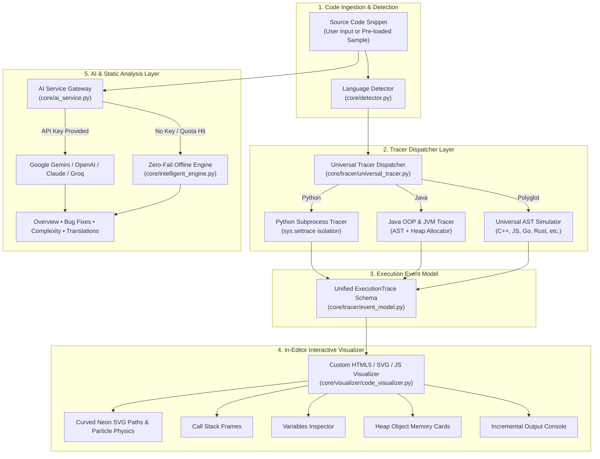

# ⚡ CodeXplain Hub

### *Interactive Animated Code Execution Visualizer & AI Developer Workspace*

[](https://codexplain.streamlit.app/)
[](https://www.python.org/downloads/)
[](https://streamlit.io/)
[](https://ai.google.dev/)
[](https://opensource.org/licenses/MIT)

> **CodeXplain Hub** transforms static source code into an **animated, step-by-step execution journey directly inside the code editor**.
> Using dynamic neon SVG Bézier curves, traveling particle physics, and synchronized debugging panels (Call Stack, Heap Allocations, Variables Inspector, and Console Stream), CodeXplain visualizes runtime flow, object allocations, constructor jumps, and variable mutations in real time.

---

## 📌 Table of Contents

- [Overview & Problem Statement](#-overview--problem-statement)
- [Key Features](#-key-features)
- [System Architecture](#-system-architecture)
- [How It Is Built](#-how-it-is-built)
- [Tech Stack](#-tech-stack)
- [Directory Structure](#-directory-structure)
- [Getting Started & Installation](#-getting-started--installation)
- [Configuration & Environment Variables](#-configuration--environment-variables)
- [Interactive Controls & Shortcuts](#-interactive-controls--shortcuts)
- [Running Unit Tests](#-running-unit-tests)
- [Contributing & License](#-contributing--license)

---

## 💡 Overview & Problem Statement

### The Problem
Traditional code debuggers and educational visualizers suffer from key limitations:
1. **Disconnected Execution Context:** Debuggers show line highlights and disconnected watch tables, forcing developers to mentally map call stacks and scope jumps back to the original code.
2. **Abstract Object Lifecycles:** Explaining Object-Oriented flows (such as constructor dispatches, parameter shadowing with `this`/`super`, and heap object references) remains abstract and confusing.
3. **API-Dependent Failure:** Most modern AI-powered coding tools fail completely when API keys are missing, invalid, or rate-limited.

### The Solution: CodeXplain Hub
CodeXplain Hub bridges the gap between code comprehension and execution mechanics:
- **In-Editor Vector Animation:** Rather than abstract diagrams, glowing neon paths curve directly between source code lines to illustrate jumps, loops, and returns.
- **Synchronized Multi-Panel State:** Simultaneously tracks stack frames, heap object instances with memory handles (`Student@0x101`), local/global variables, and standard output.
- **Dual-Engine Zero-Fail Reliability:** Couples live multi-provider LLMs (Google Gemini 2.0/1.5, OpenAI, Claude, Groq) with a **built-in offline AST intelligence engine** that delivers explanations, bug fixes, and Big-O complexity analysis even without an API key or internet connection.

---

## ✨ Key Features

### 🎬 1. In-Editor Animated Execution Visualizer
* **Direct Over-the-Code Paths:** Renders glowing neon SVG Bézier curves that route around code text without obscuring syntax.
* **Non-Sequential Flow & Jumps:** Visually handles constructor calls, distant method invocations, returns to caller lines, loop iterations, conditional branches, and exception paths.
* **60 FPS Traveling Particles:** Dynamic particles travel along the trajectory curve accompanied by directional arrowheads and event badges:
  `ENTER CONSTRUCTOR` • `CALL` • `RETURN` • `ASSIGN` • `EXECUTE` • `OUTPUT` • `LOOP` • `BRANCH`
* **Auto-Centering Smooth Scroll:** Automatically scrolls the code editor to keep the active line centered during execution.

### 🔍 2. Synchronized Runtime Debugging Panels
* **📚 Call Stack Inspector:** Live call stack frames pushed upon function entry and popped upon return.
* **🔎 Local & Global Variables:** Real-time variable inspector displaying names, types, current values, and scope boundaries.
* **📦 Interactive Heap Allocations:** Visual heap memory cards showing instantiated objects (e.g., `Student@0x101`), internal field values (`id: 101`), and color-coded pointer references.
* **💻 Incremental Live Console:** Standard output stream updated incrementally statement by statement.
* **💡 Line-by-Line Contextual Explanation:** Human-readable breakdown of the active statement, mutated variables, and why execution transitioned to the next line.

### ⚙️ 3. Multi-Engine Runtime Tracers
* **Java Execution Tracer:** Accurately models constructors, parameter shadowing, `this`/`super` keyword binding, method dispatch, and stdout. Can execute through local `javac`/`java` runtime verification.
* **Python Runtime Tracer:** Executes code in an isolated subprocess using `sys.settrace`, recording frame transitions, local variable states, and standard output.
* **Universal AST Polyglot Simulator:** Fallback execution trace generator supporting C++, JavaScript, TypeScript, Go, Rust, and Shell scripts.
* **Execution Sandbox:** Execution timeouts, subprocess isolation, and non-destructive static analysis safeguard the host environment.

### 🧠 4. Developer Intelligence Suite
* **📝 Deep Functional Overview:** High-level code analysis, input/output specifications, and Mermaid execution flowcharts.
* **🔭 Scope & Keyword Analyzer:** Deep diagnostics for `this`, `super`, closures, and lexical shadowing.
* **🛠️ Automated Bug Detection & Fixes:** Scans code for logical errors, syntax flaws, or unhandled edge cases, providing copy-ready corrected code.
* **📊 Algorithmic Complexity Profiler:** Provides algorithmic efficiency ratings (1–10) alongside Big-O time and space complexity evaluations.
* **🌐 Polyglot Cross-Language Translator:** Idiomatic code translation between Python, Java, C++, JavaScript, Go, and Rust.
* **📥 Markdown Documentation Exporter:** Exports complete analysis, traces, and code reports with a single click.

---

## 🏛️ System Architecture



---

## 🔬 How It Is Built

CodeXplain Hub combines reactive frontend rendering, low-level Python runtime instrumentation, and robust static parsing:

1. **In-Editor SVG Vector Overlay:**
   Instead of using separate graph canvases, the visualizer calculates line heights and element bounding boxes in the DOM. It injects cubic Bézier curves (`d="M x1 y1 C cx1 cy1, cx2 cy2, x2 y2"`) directly above the code lines. An internal physics loop running at 60 FPS via `requestAnimationFrame` moves glowing particles and directional markers along these paths.

2. **Runtime Tracing via `sys.settrace`:**
   Python snippets are executed inside an isolated subprocess monitored by Python's native tracing API (`sys.settrace`). This captures exact line transitions, function entries/returns, call stacks, variable mutations, and standard output without modifying user source code.

3. **Java OOP & Memory Heap Simulation:**
   For Java snippets, the tracer parses class hierarchies, constructor signatures, and method invocations. It assigns simulated virtual heap addresses (`0x101`, `0x102`), resolves variable shadowing between parameter names and instance variables (`this.id = id`), and models parent class chaining (`super(...)`).

4. **Zero-Fail Fallback Architecture:**
   The AI layer features an intelligent heuristic parser (`core/intelligent_engine.py`). If an external LLM key is absent, invalid, or rate-limited, the application seamlessly switches to its built-in AST analyzer and pattern recognition engine, ensuring 100% uptime for presentations, classrooms, and offline environments.

---

## 💻 Tech Stack

| Category | Technologies / Libraries |
| :--- | :--- |
| **Frontend & UI** | [Streamlit](https://streamlit.io/) (v1.35+), HTML5 Canvas, SVG Vector Graphics, CSS3 (Obsidian Cobalt theme), Vanilla JavaScript |
| **Execution Engines** | Python 3.10+ Runtime Tracer (`sys.settrace`), AST parser (`ast`), Subprocess sandboxing, Java Compiler & Runtime (`javac`/`java`) |
| **AI & LLM Integration** | [Google GenAI SDK](https://ai.google.dev/) (`google-genai` v2.0+), [OpenAI Python API](https://github.com/openai/openai-python), Anthropic Claude, Groq API, OpenRouter |
| **Data & Networking** | `pydantic` (v2.0+), `dataclasses`, `httpx`, `python-dotenv` |
| **Testing & CI** | Python `unittest` |

---

## 📂 Directory Structure

```text
SimpleCode/
├── .env.example                     # Sample configuration file for API keys
├── .gitignore                        # Git exclusion rules
├── README.md                         # Comprehensive project documentation
├── requirements.txt                  # Python dependencies
├── app.py                            # Streamlit entry point and UI layout
│
├── assets/
│   └── style.css                     # Obsidian Cobalt theme styling
│
├── core/
│   ├── __init__.py                   # Core package initialization
│   ├── ai_service.py                 # Multi-provider LLM gateway & offline fallback
│   ├── detector.py                   # Language detection engine
│   ├── intelligent_engine.py         # Static AST parser & zero-fail offline heuristics
│   ├── keyword_analyzer.py           # Scope analysis & keyword resolver (this/super)
│   ├── prompts.py                    # Structured system prompts and analysis templates
│   ├── sample_codes.py               # Preloaded sample snippets across languages
│   │
│   ├── tracer/
│   │   ├── __init__.py               # Tracer package definition
│   │   ├── event_model.py            # Execution event, stack frame & heap schema
│   │   ├── java_tracer.py            # Java constructor, method & heap tracer
│   │   ├── python_tracer.py          # Python sys.settrace runtime tracer
│   │   └── universal_tracer.py       # Polyglot dispatcher & AST execution simulator
│   │
│   └── visualizer/
│       ├── __init__.py               # Visualizer package definition
│       └── code_visualizer.py        # SVG vector animation & debugger component
│
└── tests/
    └── test_tracer.py                # Unit tests for tracer and event model
```

---

## 🚀 Getting Started & Installation

### Prerequisites
* **Python:** Version 3.10 or higher
* **Java (Optional):** JDK 8+ if you want to verify Java execution with the local `javac`/`java` compiler (the built-in Java simulation engine runs without Java installed).
* **Git:** Version 2.20+

### 1. Clone the Repository
```bash
git clone https://github.com/PuneetkumarHegde/SimpleCode.git
cd SimpleCode
```

### 2. Create and Activate a Virtual Environment
```bash
# Windows (PowerShell)
python -m venv .venv
.\.venv\Scripts\Activate.ps1

# macOS / Linux
python3 -m venv .venv
source .venv/bin/activate
```

### 3. Install Dependencies
```bash
pip install -r requirements.txt
```

### 4. Run the Application
```bash
python -m streamlit run app.py
```
Open your browser at **`http://localhost:8501`**.

---

## 🔑 Configuration & Environment Variables

CodeXplain Hub works out-of-the-box in **Zero-Fail Offline Mode** without any API keys.

To enable live AI-powered code analysis using Google Gemini or OpenAI:
1. Copy the example configuration:
   ```bash
   cp .env.example .env
   ```
2. Open `.env` and add your API key:
   ```env
   # Google Gemini (Recommended — Free key from https://aistudio.google.com/app/apikey)
   GEMINI_API_KEY=your_gemini_api_key_here

   # Or OpenAI / Anthropic / Groq
   OPENAI_API_KEY=your_openai_key_here
   GROQ_API_KEY=your_groq_key_here
   ```
Alternatively, enter your key on the fly using the **🔑 API Key** button in the app header.

---

## 🎮 Interactive Controls & Shortcuts

The visualizer includes intuitive playback controls and full keyboard navigation:

| Control | Action | Keyboard Shortcut |
| :--- | :--- | :--- |
| **▶ Play** | Start continuous step-by-step animation | <kbd>Space</kbd> |
| **⏸ Pause** | Freeze animation at the current execution point | <kbd>Space</kbd> |
| **⏭ Step Forward** | Advance to the next execution event | <kbd>→</kbd> or <kbd>N</kbd> |
| **⏮ Step Backward** | Rewind to the previous execution event | <kbd>←</kbd> or <kbd>P</kbd> |
| **🔄 Reset** | Reset execution to the entry statement | <kbd>R</kbd> or <kbd>Esc</kbd> |
| **Speed Selector** | Adjust animation rate (`0.5x Slow`, `1.0x Normal`, `2.0x Fast`, `4.0x Ultra`) | *Dropdown* |

---

## 🧪 Running Unit Tests

To run the automated test suite and verify the tracer engines:

```bash
python -m unittest tests/test_tracer.py
```

Expected output:
```text
...
----------------------------------------------------------------------
Ran 3 tests in 1.05s

OK
```

---

## 📄 License

This project is licensed under the [MIT License](LICENSE) — feel free to use, modify, and distribute for educational, personal, or commercial projects.

---

## 👨‍💻 Author

**Puneetkumar Hegde**  
- GitHub: [@PuneetkumarHegde](https://github.com/PuneetkumarHegde)  
- Email: pkhegde671@gmail.com
